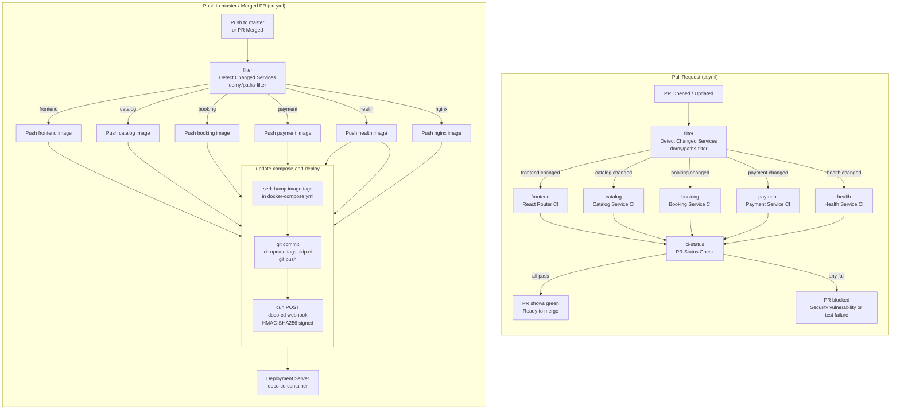

# CinemaSeat CI/CD Pipeline

This folder contains the GitHub Actions workflows for the CinemaSeat project.

---

## Workflows

| File | Trigger | Purpose |
|---|---|---|
| `ci.yml` | Pull Request (opened / sync / reopened) | Lint, test, build microservice images, Trivy scan — gates PR merge |
| `cd.yml` | Push to `master` / merged PR to `master` | Full pipeline + push microservice images to Docker Hub + doco-cd deploy |

---

## Microservice Pipeline Architecture

---

## Stage-by-Stage Breakdown

### Stage 1 — Path Filtering

Uses `dorny/paths-filter@v3` to inspect which files changed in the commit diff.

- Outputs boolean flags: `frontend`, `catalog`, `booking`, `payment`, `health`, `nginx`
- If only `frontend/**` changed, backend microservices jobs are skipped entirely
- Watching `.github/workflows/ci.yml` and `cd.yml` re-triggers all services when pipeline definitions change

### Stage 2 — Microservice Pipelines (Parallel)

Each microservice runs its test suite and builds its Docker image:

1. **Frontend (React Router v7)**
   - Install deps with `pnpm`
   - Lint with `pnpm lint`
   - TypeScript build check with `pnpm build`
   - Trivy Security scan

2. **Backend Microservices (Go 1.26)**
   - `go test -v -race ./...` and `go vet ./...` across `catalog`, `booking`, `payment`, `health-service`
   - Docker build check using individual service Dockerfiles
   - Trivy Security scan gate

### Stage 3 — Docker Hub Push (cd.yml only)

Pushes microservice-specific image tags to Docker Hub:
- `<username>/cinemaseat:catalog-<sha>`
- `<username>/cinemaseat:booking-<sha>`
- `<username>/cinemaseat:payment-<sha>`
- `<username>/cinemaseat:health-<sha>`
- `<username>/cinemaseat:nginx-<sha>`
- `<username>/cinemaseat:frontend-<sha>`

### Stage 4 — Compose Tag Bump + Deploy (cd.yml only)

1. `sed` updates matching image tags in `docker-compose.yml`
2. Commits and pushes with `[skip ci]` flag
3. Fires HMAC-SHA256 signed webhook trigger to the `doco-cd` server
4. `doco-cd` pulls updated tags and performs a rolling update via `docker compose up -d`

---

## Required Repository Secrets

| Secret | Required | Description |
|---|---|---|
| `DOCKERHUB_USERNAME` | Yes | Docker Hub account username |
| `DOCKERHUB_TOKEN` | Yes | Docker Hub access token |
| `DOCO_CD_SERVER_URL` | Yes | Full URL to doco-cd webhook |
| `WEBHOOK_SECRET` | Yes | HMAC secret shared between CI and doco-cd server |
| `BUMP_TOKEN` | Optional | GitHub PAT for protected branch tag updates |
