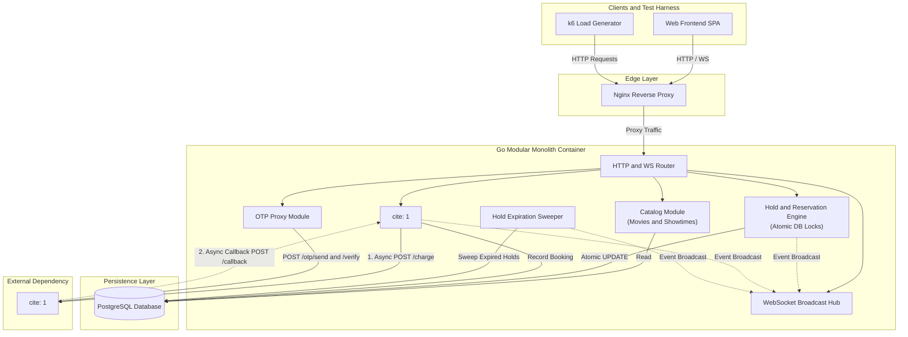
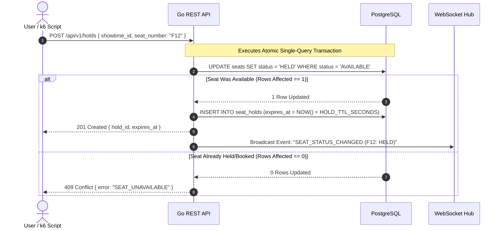

Here are the Mermaid.js system architecture and data flow diagrams for your Go Modular Monolith solution, formatted for direct inclusion in your `README.md` or architecture documentation.

---

## High-Level System Architecture



---

## Detailed Data Flow Sequences

### 1. Atomic Seat Hold Flow (Scenario A: 100 Concurrent Requests)



---

## Architectural Breakdown & Security Isolation

### 1. Nginx Reverse Proxy

- Exposes a single unified entrypoint on port `80`.

- Routes REST traffic (`/api/v1/*`) and proxies WebSocket connections (`/ws/*`) with `Upgrade` and `Connection` HTTP headers.

### 2. Go Monolith Internal Domains

- **Catalog Module**: Serves static movie, showtime, and seat map queries directly from PostgreSQL read queries.

- **Hold Engine**: Enforces atomic state transitions using single `UPDATE ... WHERE status = 'AVAILABLE'` statements. This guarantees zero oversell when multiple threads compete for seat `F12`.

- **Payment & Webhook Processor**:
- Calls `POST /charge` on the gateway asynchronously without blocking the user request.

- Listens on `POST /api/v1/payments/callback` for gateway webhooks. Processes payload inside a DB transaction and logs the `event_id` into `webhook_events` to ignore duplicate deliveries. Always returns `200 OK`.

- **Hold Expiration Sweeper**: A background Go goroutine running on a ticker interval (e.g., every 1 second) that executes:

```sql
UPDATE seats
SET status = 'AVAILABLE'
WHERE status = 'HELD' AND id IN (
    SELECT hold_id FROM seat_holds WHERE expires_at < NOW()
);

```

### 3. Fault Isolation Guarantee

- If the `mock-gateway` container stops, crashes, or returns `500` errors, the Go Monolith catches the network transport error.

- Catalog browsing, seat map queries, seat holding, and the `/health` endpoint continue executing cleanly without dependency on the gateway.
