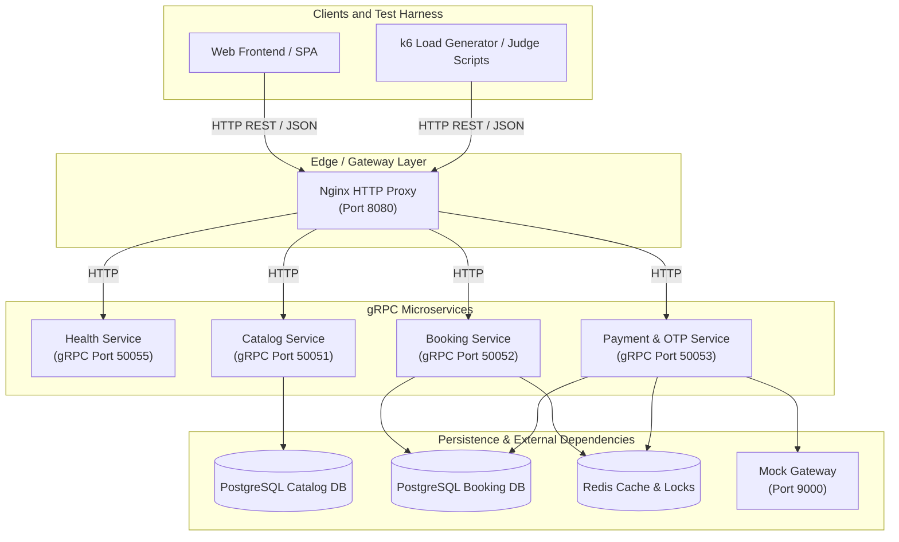

# System Architecture

## High-Level Microservice Architecture



---

## Topology Diagram

```
                                [ External Clients / Frontend / Judge Scripts ]
                                                       │
                                                       │ (HTTP REST / JSON)
                                                       ▼
                                            ┌─────────────────────┐
                                            │ Nginx Reverse Proxy │ (HTTP - Port 8080)
                                            └──────────┬──────────┘
                                                       │
         ┌───────────────────┬─────────────────────────┼─────────────────────────┬───────────────────┐
         │ (HTTP)            │ (HTTP)                  │ (HTTP)                  │ (HTTP)            │
         ▼                   ▼                         ▼                         ▼                   ▼
┌─────────────────┐ ┌─────────────────┐       ┌─────────────────┐       ┌───────────────────────┐ ┌─────────────────┐
│ Health Service  │ │ Catalog Service │       │ Booking Service │       │ Payment & OTP Service │ │ Health Service  │
│   (Port 8085)   │ │   (Port 8081)   │       │   (Port 8082)   │       │      (Port 8083)      │ │   (Port 8085)   │
└────────┬────────┘ └────────┬────────┘       └────────┬────────┘       └───────────┬───────────┘ └─────────────────┘
         │                   │                         │                            │
         │                   │                  (gRPC Inter-service) ───────────────┤
         ▼                   ▼                         ▼                            ▼
┌─────────────────┐ ┌─────────────────┐       ┌─────────────────┐           ┌─────────────────┐
│ Health Monitor  │ │ DB 1: Postgres  │       │ DB 2: Postgres  │           │   DB 3: Redis   │
│                 │ │  (Catalog DB)   │       │  (Booking DB)   │           │  (Lock/TTL DB)  │
└─────────────────┘ └─────────────────┘       └─────────────────┘           └─────────────────┘
```

---

## Service Specifications

### 1. Reverse Proxy Layer
- **Nginx HTTP Entrypoint (Port 8080)**: Receives external HTTP REST requests from frontends and judge scripts. Routes calls to specific microservices based on request path.

### 2. Microservice Layer
- **Health Service (`Port 8085` / `gRPC 50055`)**: Dedicated microservice for `GET /health` system health monitoring. Evaluates DB/Redis connectivity and guarantees sub-second response times ($< 1.0\text{ second}$).
- **Catalog Service (`Port 8081` / `gRPC 50051`)**: Manages movie listings, showtime details, and seat map queries. Connects to `Catalog DB`.
- **Booking Service (`Port 8082` / `gRPC 50052`)**: Handles seat reservations and hold logic. Uses Redis for atomic distributed locking and `Booking DB` for bookings.
- **Payment & OTP Service (`Port 8083` / `gRPC 50053`)**: Manages transaction charges, callback webhooks, and OTP verification workflows. Interacts with `Booking DB`, Redis, and the external Mock Gateway.

### 3. Data & External Layer
- **PostgreSQL (Catalog DB)**: Dedicated store for movies, theatres, halls, seats, and showtimes catalog tables.
- **PostgreSQL (Booking DB)**: Transactional store for showtime seats, bookings, and payments tables.
- **Redis**: Fast cache for distributed locks, seatmap cache, and short-term OTP codes.
