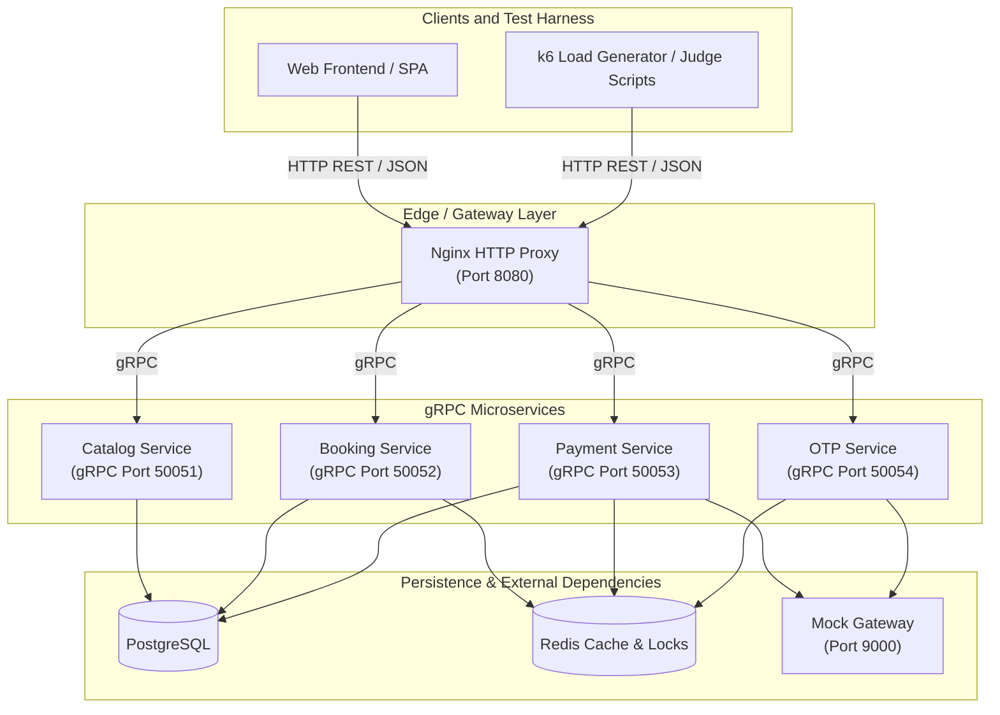

# System Architecture

## High-Level Microservice Architecture



---

## Topology Diagram

```
                                [ External Clients / Frontend / Judge Scripts ]
                                                       │
                                                       │ (HTTP REST / JSON)
                                                       ▼
                                            ┌─────────────────────┐
                                            │        nginx        │ (HTTP - Port 8080)
                                            └──────────┬──────────┘
                                                       │
                     ┌───────────────────┬─────────────┴─────┬───────────────────┐
                     │ (gRPC)            │ (gRPC)            │ (gRPC)            │ (gRPC)
                     ▼                   ▼                   ▼                   ▼
           ┌─────────────────┐ ┌─────────────────┐ ┌─────────────────┐ ┌─────────────────┐
           │ Catalog Service │ │ Booking Service │ │ Payment Service │ │   OTP Service   │
           │  (gRPC 50051)   │ │  (gRPC 50052)   │ │  (gRPC 50053)   │ │  (gRPC 50054)   │
           └────────┬────────┘ └────────┬────────┘ └────────┬────────┘ └────────┬────────┘
                    │                   │                   │                   │
                    └─────────┬─────────┴───────────┬───────┴───────────────────│
                              ▼                     ▼                           ▼
                       ┌──────────────┐      ┌──────────────┐            ┌──────────────┐
                       │  PostgreSQL  │      │    Redis     │            │ Mock Gateway │
                       └──────────────┘      └──────────────┘            └──────────────┘
```

---

## Service Specifications

### 1. Reverse Proxy / Gateway Layer
- **Nginx HTTP Entrypoint (Port 8080)**: Receives external HTTP REST requests (JSON payloads) from frontends and judge scripts. Translates and routes calls to specific internal microservices over gRPC protocol.

### 2. Microservice Layer (gRPC Decoupled)
- **Catalog Service (`gRPC 50051`)**: Manages movie listings, showtime details, and seat map queries. Connects directly to PostgreSQL.
- **Booking Service (`gRPC 50052`)**: Handles seat reservations and hold logic. Uses Redis (`SETNX`) for atomic distributed locking and PostgreSQL for persistent booking records.
- **Payment Service (`gRPC 50053`)**: Manages transaction charges, idempotency check via Redis, and callback webhooks. Interacts with PostgreSQL, Redis, and Mock Gateway.
- **OTP Service (`gRPC 50054`)**: Handles OTP generation, verification, and dispatch via Mock Gateway and Redis.

### 3. Data & External Layer
- **PostgreSQL**: Primary relational storage for movies, showtimes, seats, holds, and bookings.
- **Redis**: Fast key-value store for atomic locks (`HOLD_TTL_SECONDS`), seatmap caching, and idempotency deduplication.
- **Mock Gateway (Port 9000)**: External gateway dependency providing payment processing (`/charge`) and OTP delivery (`/otp/send`, `/otp/verify`).
