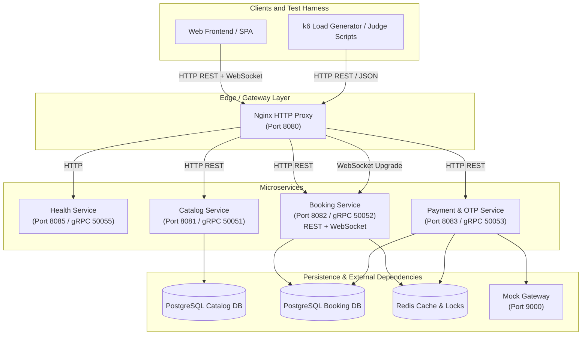

# 🎬 CinemaSeat — Scalable Movie Ticket Booking System

> **IEEE CUET Hackathon** · Team: _That_Team_IEEE_
>
> A microservice-based movie ticket booking platform designed to handle high-concurrency seat reservations without double-booking — built for the _Zero to Production Phase 2_ hackathon.

---

## 📋 Project Status

### ✅ What We Accomplished

| Milestone            | Status      | Details                                                                                                                                                                                                                                                 |
| -------------------- | ----------- | ------------------------------------------------------------------------------------------------------------------------------------------------------------------------------------------------------------------------------------------------------- |
| **System Design**    | ✅ Complete | Full microservice architecture designed with clear service boundaries, concurrency strategy (Redis SETNX + PG `SELECT FOR UPDATE`), database schemas, and comprehensive API contracts. See [`ARCHITECTURE.md`](ARCHITECTURE.md) and [`API.md`](API.md). |
| **Backend Services** | ✅ Complete | All four gRPC/HTTP microservices implemented in Go — Catalog, Booking, Payment & OTP, and Health. Includes distributed locking, idempotent webhook handling, automatic hold expiry, and gateway retry logic.                                            |
| **Frontend Build**   | ✅ Complete | Full SPA built with React Router v8, TypeScript, and Tailwind CSS v4. Six pages implemented: Landing, Sign Up, Sign In, Browse Movies, Movie Details, Seat Selection, and Payment.                                                                      |
| **CI/CD Pipeline**   | ✅ Complete | GitHub Actions pipeline for PR checks and automated deployment.                                                                                                                                                                                         |

### ❌ What We Did Not Complete

| Milestone                          | Status           | Reason                                                                                                                                                                           |
| ---------------------------------- | ---------------- | -------------------------------------------------------------------------------------------------------------------------------------------------------------------------------- |
| **Backend ↔ Frontend Integration** | ❌ Not completed | The backend APIs and the frontend were developed in parallel but could not be wired together within the hackathon time constraint. The frontend currently uses static/mock data. |
| **Deployment**                     | ❌ Not completed | Docker Compose files and Dockerfiles are ready, but the system was not deployed to a production VM/cloud instance.                                                               |

---

## 🏗️ System Architecture

### High-Level Microservice Architecture



### Topology Diagram

```
                          [ External Clients / Frontend / Judge Scripts ]
                                                 │
                                                 │ HTTP REST + WebSocket
                                                 ▼
                                      ┌─────────────────────┐
                                      │ Nginx Reverse Proxy │ (Port 8080)
                                      └──────────┬──────────┘
                                                 │
         ┌──────────────┬────────────────────────┼────────────────────────┬──────────────┐
         │ (HTTP)       │ (HTTP)                 │ (HTTP + WS)           │ (HTTP)       │
         ▼              ▼                        ▼                       ▼              │
┌──────────────┐ ┌──────────────┐       ┌────────────────────┐   ┌──────────────────┐   │
│   Health     │ │   Catalog    │       │  Booking Service   │   │ Payment & OTP    │   │
│   Service    │ │   Service    │       │   (Port 8082)      │   │    Service       │   │
│ (Port 8085)  │ │ (Port 8081)  │       │                    │   │  (Port 8083)     │   │
│              │ │              │       │  ┌──────┐ ┌─────┐  │   │                  │   │
│              │ │              │       │  │ REST │ │ WS  │  │   │                  │   │
│              │ │              │       │  └──────┘ └─────┘  │   │                  │   │
└──────┬───────┘ └──────┬───────┘       └────────┬───────────┘   └────────┬─────────┘   │
       │                │                        │                       │              │
       │                │                 (gRPC Inter-service) ──────────┤              │
       ▼                ▼                        ▼                       ▼              ▼
┌──────────────┐ ┌──────────────┐       ┌──────────────┐          ┌──────────────┐ ┌──────────────┐
│    Health    │ │ DB: Postgres │       │ DB: Postgres │          │  DB: Redis   │ │    Health    │
│   Monitor   │ │ (Catalog DB) │       │ (Booking DB) │          │ (Lock/TTL)   │ │   Monitor   │
└──────────────┘ └──────────────┘       └──────────────┘          └──────────────┘ └──────────────┘
```

---

## ⚙️ Services Overview

### 1. Nginx Reverse Proxy (Port 8080)

The single HTTP entrypoint for all clients. Routes requests to the appropriate microservice based on URL path prefix.

| Path Prefix                             | Routed To                   |
| --------------------------------------- | --------------------------- |
| `/health`                               | Health Service              |
| `/api/v1/movies*`, `/api/v1/showtimes*` | Catalog Service             |
| `/api/v1/holds*`, `/api/v1/bookings*`   | Booking Service (REST)      |
| `/ws/showtimes*`                        | Booking Service (WebSocket) |
| `/api/v1/payments*`, `/api/v1/otp*`     | Payment Service             |

### 2. Health Service (Port 8085 / gRPC 50055)

Dedicated `GET /health` endpoint. Probes Catalog DB, Booking DB, Redis, and the Mock Gateway. Returns aggregated status in under 1 second — even if the gateway is down (reports `DEGRADED`).

### 3. Catalog Service (Port 8081 / gRPC 50051)

Stateless, read-only service for movie listings, showtime details, and seat maps. Backed by the Catalog PostgreSQL database with optional Redis caching (5s TTL).

### 4. Booking Service (Port 8082 / gRPC 50052)

Handles seat holds and the full booking lifecycle. Exposes **both REST and WebSocket** interfaces:

- **REST API** — `POST /holds` (atomic seat reservation), `POST /bookings` (create booking), `GET /bookings/:ref` (poll status), `GET /bookings/:showtime_id/seats` (seat map fallback).
- **WebSocket** — `WS /ws/showtimes/:showtime_id` pushes the full seat map on connect and broadcasts every seat status change (`AVAILABLE` → `HELD` → `BOOKED`) in real time to all connected clients.

Uses a **dual-lock strategy** to prevent double-booking:

- **Redis `SETNX`** with `HOLD_TTL_SECONDS` expiry — fast-path distributed lock.
- **PostgreSQL `SELECT FOR UPDATE`** — secondary guard against edge-case races when a Redis key expires mid-transaction.

A background goroutine scans and releases expired holds every 5 seconds.

### 5. Payment & OTP Service (Port 8083 / gRPC 50053)

Manages the payment flow with the unreliable Mock Gateway:

- **OTP dispatch** with retry (up to 3 attempts, backoff).
- **Non-blocking charge** (`POST /charge`) — returns 202 immediately.
- **Idempotent webhook handler** — deduplicates callbacks by `event_id` in Redis (24h TTL).
- On `SUCCEEDED`: confirms booking via gRPC to Booking Service.
- On `FAILED`: releases seat and marks booking failed.

---

## 🛡️ Concurrency & Reliability Design

| Challenge                    | Solution                                                     |
| ---------------------------- | ------------------------------------------------------------ |
| Double-booking prevention    | Redis `SETNX` + PG `FOR UPDATE` dual-lock                    |
| Automatic hold expiry        | Redis key TTL + background goroutine cleanup                 |
| Duplicate webhooks (8% rate) | Redis idempotency key on `event_id`                          |
| Payment failures (10% rate)  | Callback marks booking `FAILED`, seat released               |
| Gateway timeouts (2% rate)   | Exponential backoff retry on `/charge`                       |
| Lost OTPs (10% rate)         | Payment Service retries up to 3x; frontend "Resend" button   |
| Dynamic hold duration        | `HOLD_TTL_SECONDS` read from environment variable at runtime |

---

## 🖥️ Tech Stack

### Backend

- **Language**: Go 1.25
- **HTTP Framework**: Gin
- **Database**: PostgreSQL 16 (via `pgx/v5` driver, `sqlc` for type-safe queries)
- **Cache & Locks**: Redis 7 (`go-redis/v9`)
- **Inter-service Communication**: gRPC with Protocol Buffers
- **DB Migrations**: `golang-migrate/v4`
- **Logging**: `zap` (structured logging)

### Frontend

- **Framework**: React 19 + React Router v8 (SSR-capable)
- **Language**: TypeScript
- **Styling**: Tailwind CSS v4
- **Auth**: Clerk (`@clerk/clerk-react`)
- **Build Tool**: Vite 8

### Infrastructure

- **Containerization**: Docker + Docker Compose
- **Reverse Proxy**: Nginx
- **Mock Payment Gateway**: `asifmahmoud414/mock-gateway:latest`

---

## 🎨 Frontend Pages

| Route                         | Page           | Description                                      |
| ----------------------------- | -------------- | ------------------------------------------------ |
| `/`                           | Landing        | Hero landing page                                |
| `/sign-up`                    | Sign Up        | User registration via Clerk                      |
| `/sign-in`                    | Sign In        | User authentication via Clerk                    |
| `/browse`                     | Browse Movies  | Grid of available movies                         |
| `/movie/:movie_id`            | Movie Details  | Movie info, description, and showtime list       |
| `/select_seat/:movie_id`      | Seat Selection | Interactive seat map with real-time availability |
| `/payment/:movie_id/:seat_id` | Payment        | OTP verification and payment checkout flow       |

---

## 📡 API Summary

Full API documentation is available in [`API.md`](API.md).

### Core Booking Flow

```
[1] WS Connect        →  GET live seat map via WebSocket
[2] Hold Seat          →  POST /api/v1/holds (Redis SETNX + PG lock)
[3] Create Booking     →  POST /api/v1/bookings (returns booking_ref)
[4] Send OTP           →  POST /api/v1/otp/send (retried up to 3x)
[5] Verify OTP         →  POST /api/v1/otp/verify (triggers /charge)
[6] Gateway Callback   →  POST /api/v1/payments/callback (async, 2–15s)
[7] Poll Status        →  GET /api/v1/bookings/:ref (CONFIRMED / FAILED / EXPIRED)
```

### Key Endpoints

| Method | Endpoint                       | Service | Purpose                       |
| ------ | ------------------------------ | ------- | ----------------------------- |
| `GET`  | `/health`                      | Health  | Aggregated health check (<1s) |
| `GET`  | `/api/v1/movies`               | Catalog | List all movies               |
| `GET`  | `/api/v1/movies/:id/showtimes` | Catalog | Showtimes for a movie         |
| `GET`  | `/api/v1/showtimes/:id/seats`  | Catalog | Seat map (REST fallback)      |
| `WS`   | `/ws/showtimes/:id`            | Booking | Live seat map via WebSocket   |
| `POST` | `/api/v1/holds`                | Booking | Atomic seat hold              |
| `POST` | `/api/v1/bookings`             | Booking | Create booking (202 async)    |
| `GET`  | `/api/v1/bookings/:ref`        | Booking | Poll booking status           |
| `POST` | `/api/v1/otp/send`             | Payment | Send OTP                      |
| `POST` | `/api/v1/otp/verify`           | Payment | Verify OTP → triggers charge  |
| `POST` | `/api/v1/payments/callback`    | Payment | Gateway webhook (idempotent)  |

---

## 🚀 Local Setup

### Prerequisites

- Docker & Docker Compose
- Node.js 20+ and pnpm (for frontend development)
- Go 1.25+ (for backend development)

### Quick Start (Docker)

```bash
# 1. Clone the repository
git clone https://github.com/TheSR007/That_Team_IEEE.git
cd That_Team_IEEE

# 2. Copy environment variables
cp .env.example .env
# Edit .env with your values

# 3. Start all services
docker compose up -d
```

> **Note:** Due to incomplete integration, the frontend container may not connect to backend APIs. See [Project Status](#-project-status) above.

### Development Mode

**Backend** (each service runs independently):

```bash
cd backend/catalog
go run ./cmd/main.go
```

**Frontend**:

```bash
cd frontend
pnpm install
pnpm dev
```

The frontend dev server starts at `http://localhost:5173`.

---

## 📁 Project Structure

```
That_Team_IEEE/
├── backend/
│   ├── catalog/           # Catalog Service (movies, showtimes, seats)
│   │   ├── cmd/           # Service entrypoint
│   │   ├── config/        # Configuration loading
│   │   ├── db/            # Migrations & sqlc-generated queries
│   │   ├── handler.go     # HTTP route handlers
│   │   └── service.go     # Business logic
│   ├── booking/           # Booking Service (holds, bookings, WebSocket)
│   │   ├── cmd/           # Service entrypoint
│   │   ├── db/            # Migrations & queries
│   │   ├── handler.go     # HTTP/WS route handlers
│   │   └── service.go     # Business logic + dual-lock strategy
│   ├── payment/           # Payment & OTP Service
│   │   ├── cmd/           # Service entrypoint
│   │   ├── handler.go     # HTTP route handlers
│   │   └── service.go     # Gateway interaction + idempotency
│   ├── health-service/    # Health Service
│   │   ├── controller/    # HTTP handlers
│   │   ├── healthchecker/ # Probe logic for DB/Redis/Gateway
│   │   └── main.go        # Entrypoint
│   ├── nginx/             # Nginx reverse proxy config
│   │   └── nginx.conf
│   └── pkg/               # Shared packages
├── frontend/
│   ├── app/
│   │   ├── Components/    # Reusable UI components (per-page modules)
│   │   ├── context/       # React context providers
│   │   ├── data/          # Static/mock data files
│   │   ├── routes/        # Page route components
│   │   ├── types/         # TypeScript type definitions
│   │   ├── root.tsx       # App shell & providers
│   │   └── routes.ts      # Route definitions
│   ├── public/            # Static assets
│   └── package.json
├── api/                   # Proto definitions / API specs
├── docker-compose.yml     # Production compose (pre-built images)
├── docker-compose.dev.yml # Development compose (builds from source)
├── ARCHITECTURE.md        # Detailed architecture documentation
├── API.md                 # Complete API reference
├── .env.example           # Environment variable template
└── README.md              # ← You are here
```

---

## 🔧 Environment Variables

Copy `.env.example` to `.env` and configure:

| Variable                     | Description                         | Default                 |
| ---------------------------- | ----------------------------------- | ----------------------- |
| `DOCKERHUB_USERNAME`         | Docker Hub username for image pulls | —                       |
| `VITE_API_BASE_URL`          | Backend base URL for frontend       | `http://localhost:8080` |
| `VITE_CLERK_PUBLISHABLE_KEY` | Clerk auth publishable key          | —                       |
| `HOLD_TTL_SECONDS`           | Seat hold expiry duration           | `120`                   |
| `POSTGRES_USER`              | PostgreSQL username                 | `app`                   |
| `POSTGRES_PASSWORD`          | PostgreSQL password                 | `secret`                |
| `POSTGRES_DB`                | PostgreSQL database name            | `cinemaseat`            |
| `REDIS_HOST`                 | Redis hostname                      | `redis`                 |
| `REDIS_PORT`                 | Redis port                          | `6379`                  |

---

## 📚 Additional Documentation

- [**ARCHITECTURE.md**](ARCHITECTURE.md) — Full system architecture with Mermaid diagrams and service specifications
- [**API.md**](API.md) — Complete REST API and WebSocket documentation with request/response examples
- [**Hackathon Problem Statement**](hackathon%20problem%20statement.md) — Original competition brief and judging criteria

---

## 👥 Team

**That_Team_IEEE** — IEEE CUET Hackathon, _Zero to Production Phase 2_
